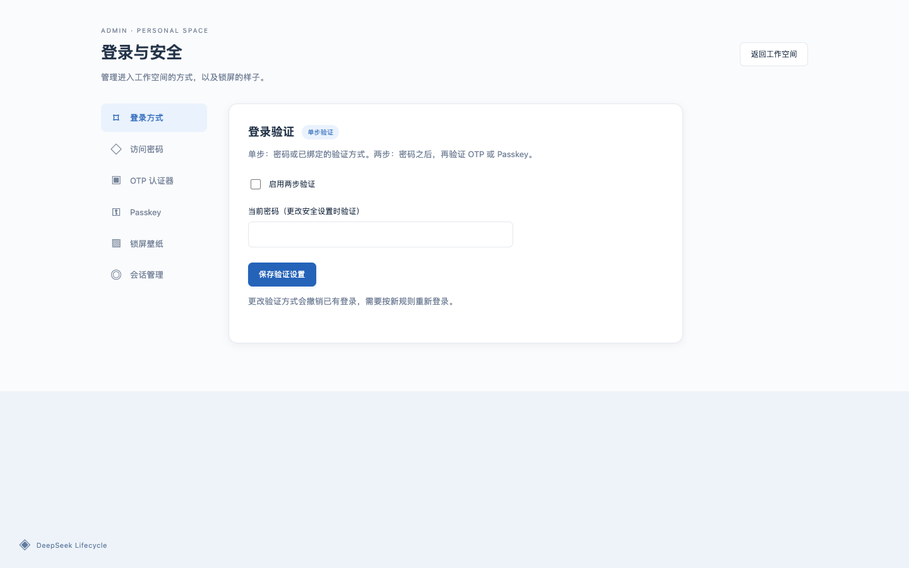

# DSH Lifecycle · DeepSeek 生命周期管理

> **仅支持 DeepSeek Harness Web 版：这是专为 Web profile 设计的插件，不支持 Electron Desktop 桌面版。**
>
> **不要安装到 Desktop profile。** Windows 支持仅指 Windows 上的 **Web 版**，不是 Windows Desktop 应用。Desktop 的随机端口和原生 `dsh-app://` 通道与本插件的 Web 网关不兼容，误装可能导致启动或重启失败。重置密码不能修复 Desktop 启动问题。
>
> **安装完成后，请立即刷新当前页面，或打开 `/login`。**
>
> **旧页面显示「无法连接」或 HTTP 401，不代表插件安装失败。** 登录验证已经启用，旧页面尚未登录，而且可能连插件的弹窗代码也加载不到。此时必须手动刷新，不要反复卸载重装。
>
> 随机初始密码直接显示在首次设置页，**终端不会打印密码**；验证后必须改成自己的密码。Windows 用户登录后可在 **「电源 → 启用电源控制 → 启用并重启」** 自动配置后台服务，无需打开终端。

专为单用户 DeepSeek Harness **Web 版**提供锁屏、登录验证和服务电源管理。

- Windows 风格锁屏与首次设置引导，支持自定义壁纸。
- 密码、OTP、Passkey，支持单步或两步验证；已完成的登录可跨服务重启保留。
- 侧边栏「电源」菜单：锁定、重启、关机，以及检测到新版时的更新并重启。
- DSH 内的「登录与安全」页面，分区管理密码、验证方式、壁纸和登录会话。

## 界面预览




更多截图见 [screenshots.json](screenshots.json)，供插件市场展示。

## 安装

**安装完成后必须刷新当前页面，进入登录或首次设置。** 旧页面显示「无法连接」或接口返回 **HTTP 401**，通常表示新登录验证已生效、当前浏览器尚未登录，并不代表插件安装失败。请刷新页面或访问 `/login`，不要因此反复卸载重装。

需要 Node.js **≥ 22.18** 和 DSH Web，同时满足 Harness 自身更高的 Node 版本要求。电源操作依赖独立控制服务：Linux 使用 systemd，macOS 使用 launchd；Windows 可直接在页面一键安装当前用户的计划任务。Windows 11 已完成真实 Harness 页面启用、登录、锁屏、重启、停止、独立 npm 更新及故障回滚实测，验证范围见 [Windows 验证记录](docs/WINDOWS-VALIDATION.md)。源码及全局共享安装支持重启和停止，但不自动替换源码或共享包目录；自动更新仅适用于按部署说明配置的独立 npm 安装。

```bash
dsh plugin --profile web add dsh-lifecycle
```

也可从 GitHub 安装：`dsh plugin --profile web add github:floatDreamWithSong/dsh-lifecycle`。仓库包含已构建的 `dist`，安装时不需要执行构建脚本。0.1.7 的旧 GitHub 安装缺少这些文件，应重新安装更新后的提交，或改用 npm 来源。

**只安装到 Web profile，不要安装到 Electron Desktop profile。** 本插件不提供 Desktop 锁屏、初始密码或电源控制，也不承诺 Desktop 适配。Windows 11 的实测结果均指 Windows 上运行的 Web 版。

请使用运行 Harness 的账户，以及相同的 HOME / DSH_HOME 安装。

Windows 首次登录后点击 **「电源 → 启用电源控制 → 启用并重启」**，插件会识别当前启动命令、端口和数据目录，安装当前用户的后台任务，然后自动恢复页面。启用会中断正在运行的任务；后续登录 Windows 时自动启动 Harness。Linux/macOS 及自定义 Windows 部署见[部署说明](docs/DEPLOYMENT.md)；公网部署还需配置 HTTPS。

## 使用

**初始密码只对未初始化的数据目录展示。** 插件使用 `$DSH_HOME`（默认 `~/.dsh`）保存认证记录，卸载重装或切换 profile 不会清空密码。如果该目录已有个人密码，页面会直接显示登录，不会再次展示初始密码；请使用原密码。忘记密码时，应先停止共用该目录的实例，再按部署说明备份重置；不要把已有密码公开成“初始密码”。

1. 首次访问时，随机初始密码直接显示在首次设置页，无需查看终端；验证后必须立即改为自己的密码，再设置验证方式。
2. 点击锁屏或按 Enter 进入登录。登录后，从侧边栏或「电源 → 登录与安全」进入设置。
3. 在「锁屏壁纸」上传、选择或删除背景；支持 PNG、JPEG、WebP，每张最多 **5 MB**，最多 **12 张**，可随时恢复内置壁纸。
4. 「锁定」只退出当前浏览器；「关机」停止 Harness 服务，之后需在服务器启动，**不会关闭操作系统**。

```bash
# 以下服务名按实际部署替换
sudo journalctl -u deepseek-harness.service -n 100 --no-pager
sudo systemctl start deepseek-harness.service
```

## 注意事项

- **首次设置页会公开展示临时初始密码。** 可访问该页面的人都可能抢先完成初始化，请先在本机或受控网络内完成改密，再开放公网。初始密码在完成改密后从记录中删除，不再展示；终端不打印密码。已设置的个人密码不会明文保存或展示。

- **公网部署使用 HTTPS。** 网关放在反向代理之后，内部 Harness 端口仅监听回环地址；会话 Cookie 启用 Secure。
- **Passkey 需要稳定的 HTTPS 域名，公网 IP 不支持。** 可先用密码或 OTP，之后在 Passkey 标签页保存域名，从该域名访问后绑定。
- **两步验证必须先验证密码，再验证 OTP / Passkey。** 忘记密码时，第二因素不能跳过第一步；保留服务器管理入口和 OTP 备份代码。
- **登录默认有效期 30 天。** 锁定、改密、变更验证策略或绑定／移除因素会撤销相应登录。
- **定期备份插件数据**，备份文件不要上传到 Git。
- **当前壁纸对未登录访客可见**，图库管理需要登录。不要用包含隐私信息的图片作为锁屏背景。
- 中国内地服务器使用域名前，需完成所需的备案及接入手续。

详细配置、密码恢复与卸载见[部署说明](docs/DEPLOYMENT.md)。

## 许可

[MIT](LICENSE)。
